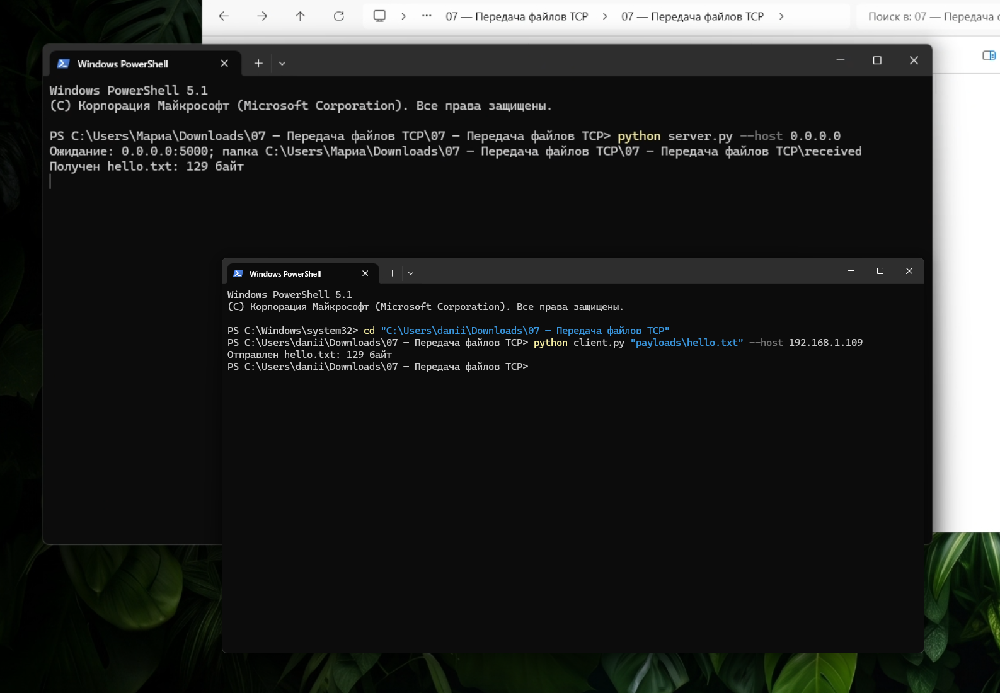
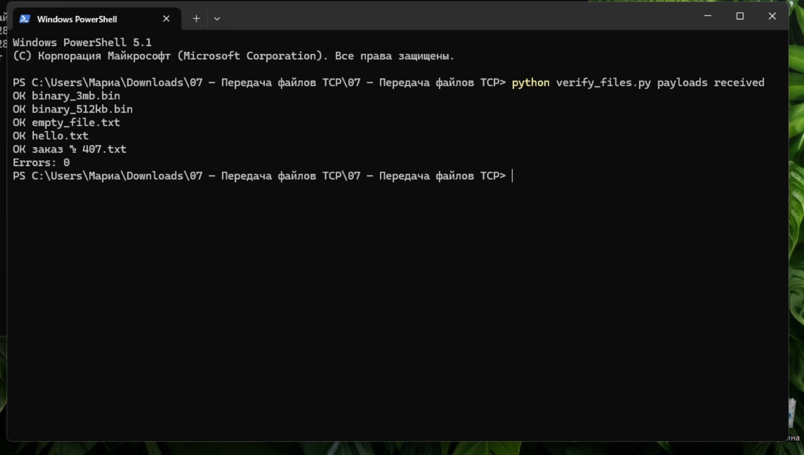

# Передача файлов по TCP

## Цель

Реализовать TCP-клиент и сервер для передачи файлов по локальной сети с проверкой целостности.

## Реализация

Сервер `server.py` принимает соединения и сохраняет файлы в папку `received`. Клиент `client.py` отправляет имя и размер файла, а затем его содержимое частями. Сервер получает данные в цикле, записывает их во временный файл и после полного приёма заменяет конечный файл. Клиент получает подтверждение сервера. При обрыве временный файл удаляется, а ранее полученный файл сохраняется.

## Проверка

На одном компьютере проверены все файлы из `payloads`, повторная отправка и обрыв соединения до окончания передачи. Существующий файл после обрыва сохранился, временный файл удалился. Проверка `verify_files.py` показала `Errors: 0`.

На двух компьютерах в локальной сети переданы текстовые файлы, файл с кириллическим именем и двоичные файлы размером 512 КБ и 3 МБ. `hello.txt` передан повторно под тем же именем. Проверка SHA-256 на принимающем компьютере:

```text
OK binary_3mb.bin
OK binary_512kb.bin
OK empty_file.txt
OK hello.txt
OK заказ № 407.txt
Errors: 0
```

Файл `empty_file.txt` из исходного набора содержит один байт; его исходное содержимое не изменялось. Обрыв передачи между двумя компьютерами отдельно не проверялся.

## Скриншоты

Передача файла между двумя компьютерами:



Проверка SHA-256 полученных файлов:


