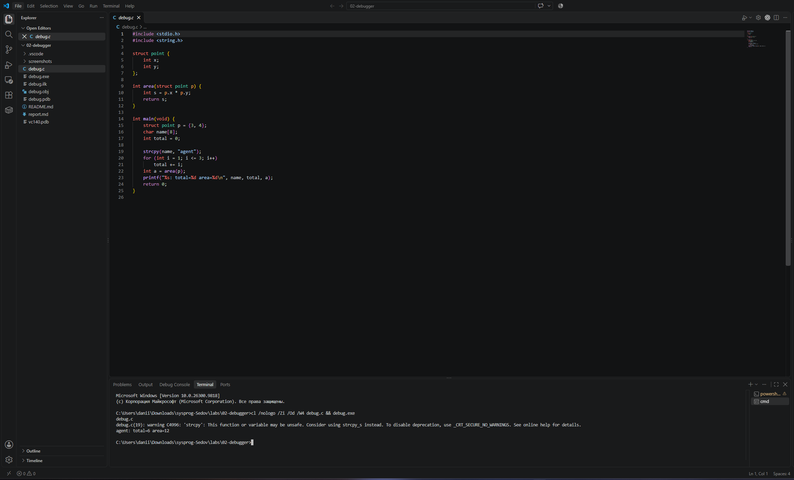
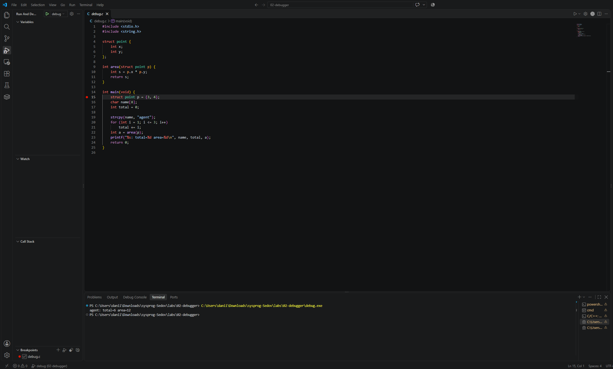
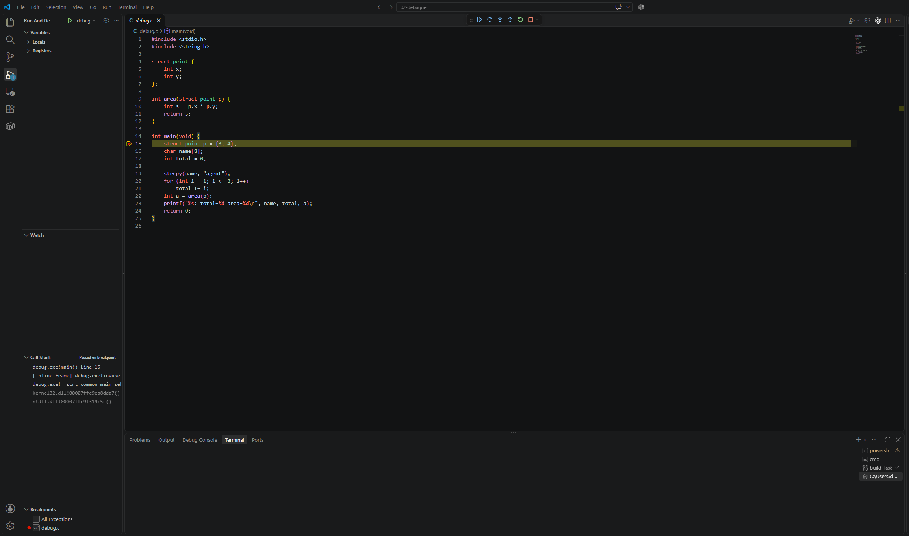
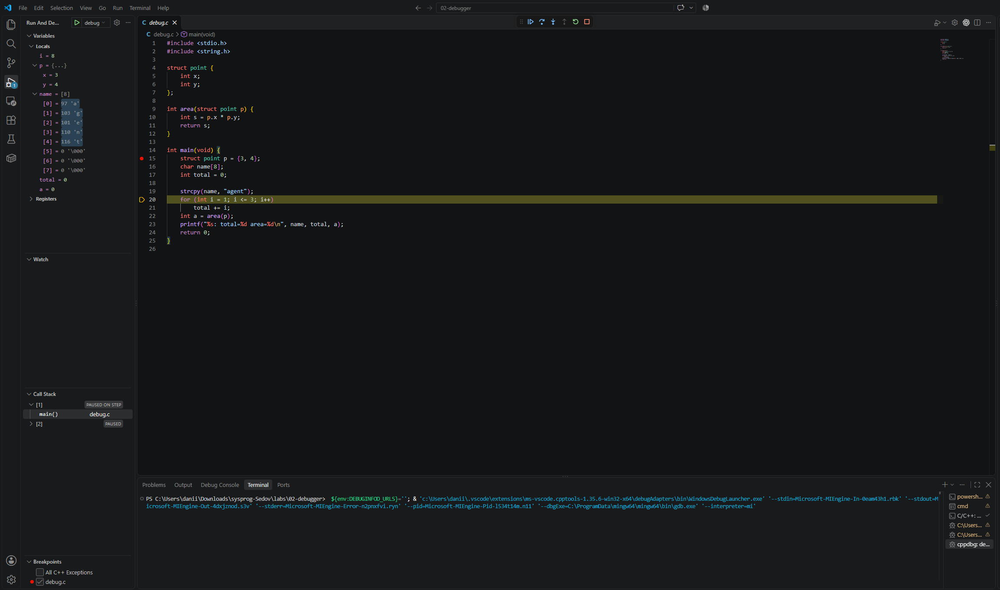
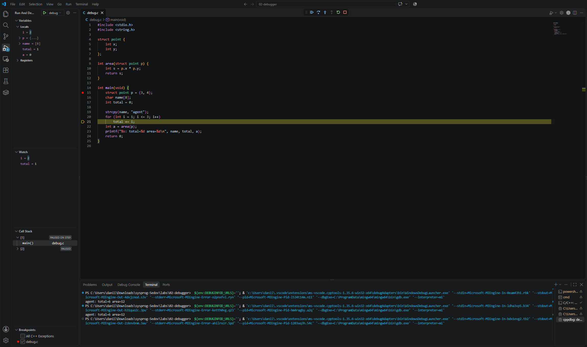
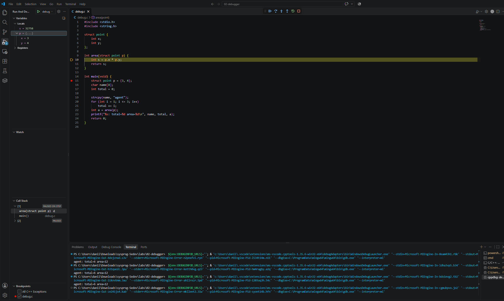
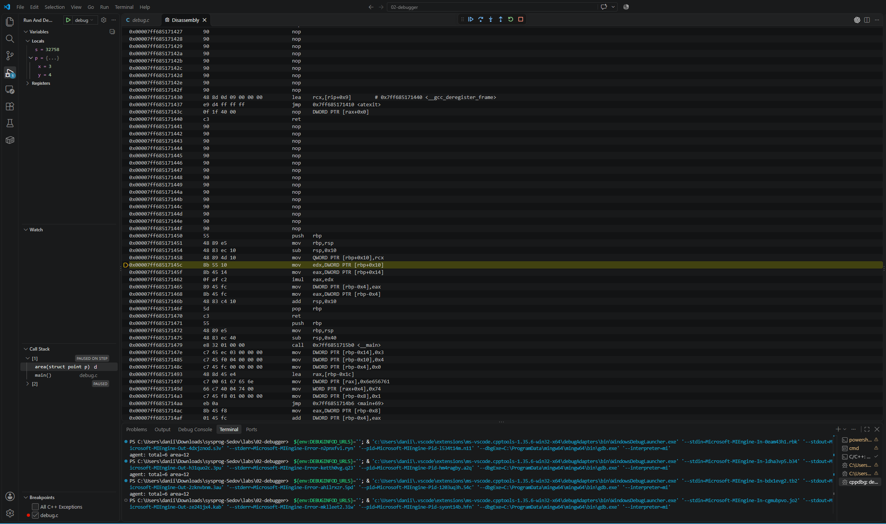
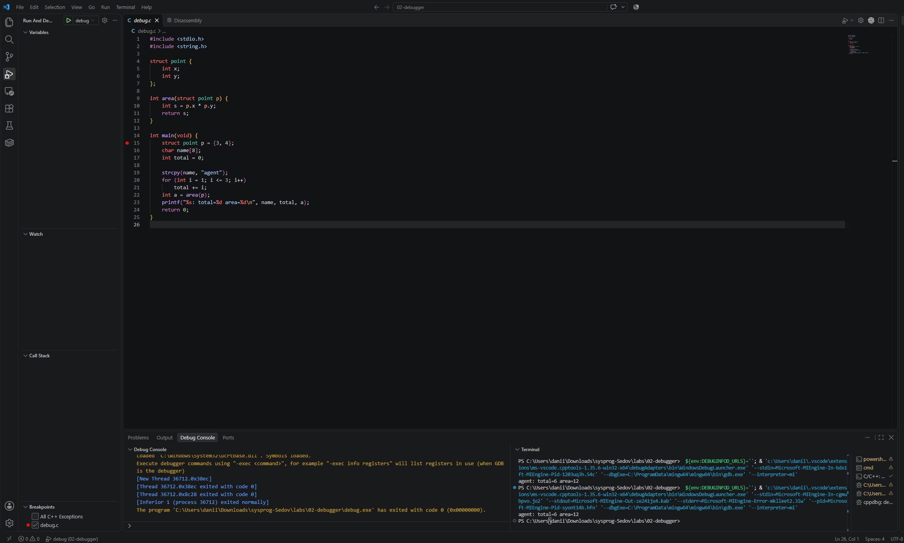

# ЛР 2. Программа в отладчике

Система: Windows x64 · отладчик: GDB (MinGW) в VS Code.

## Остановка и переменные

Программа без отладчика напечатала: `agent: total=6 area=12`.
Точка останова установлена на строке 15.
До выполнения строки 15 в одном из запусков отладчик показывал `p.x = 0`, `p.y = 0`, `total = 0`. Эти значения до инициализации не определены и могут отличаться при другом запуске.
После строки 15: `p.x = 3`, `p.y = 4`.
Строка 16 — объявление массива без инициализации; отдельного исполняемого действия для неё отладчик не показал.
`name[0] = 97` (буква `a`), завершающий ноль находится в `name[5]`.

## Цикл и функция

На кадре цикла: `i = 2`, `total = 1`; после выполнения `total += i` значение `total = 3`.
В стеке внутри `area` видны две строки: сверху `area`, ниже `main`.
Команда умножения в машинном коде: `imul eax, edx`.
Перед `printf`: `a = 12`, `total = 6`.
Код завершения программы: `0`.

## Помощник ИИ (Р1)

Запрос: «Почему до выполнения строки 15 в p.x лежит случайное число?». Ответ совпал с объяснением шага 4: до выполнения инициализации отладчик может показывать неопределённое содержимое памяти, в том числе ноль.

Не получилось: в контекстном меню не было пункта открытия дизассемблера; открыл его через палитру команд VS Code. ИИ использовал для помощи с отладкой и заполнения отчёта.

## Скриншоты

