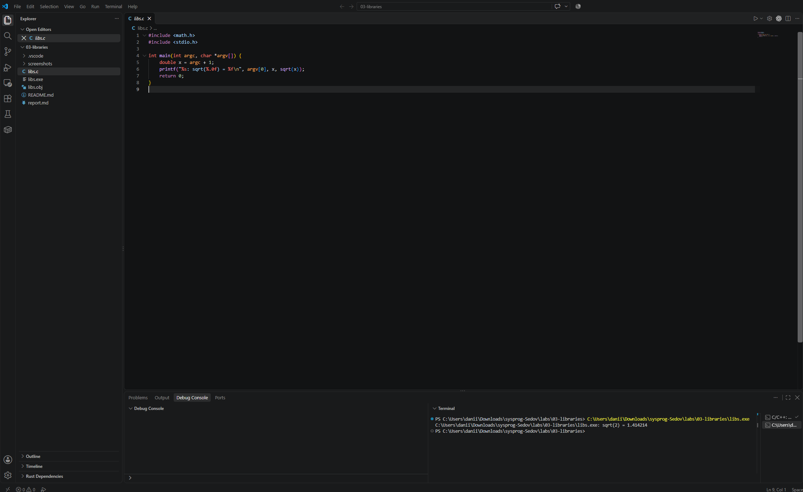
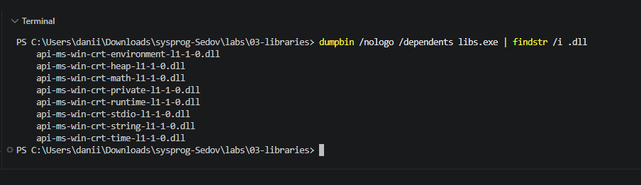
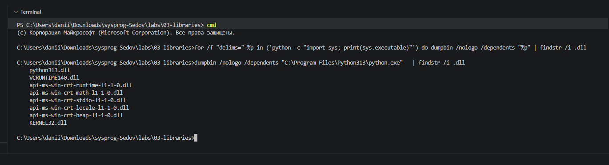
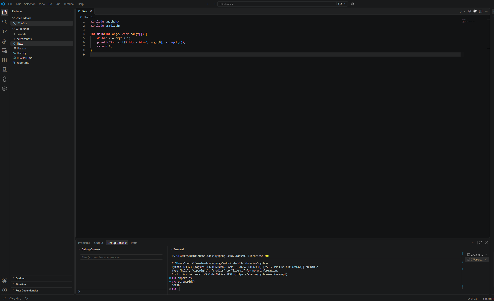
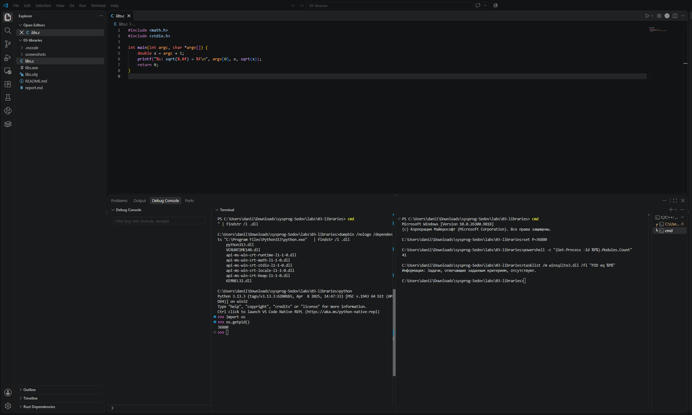
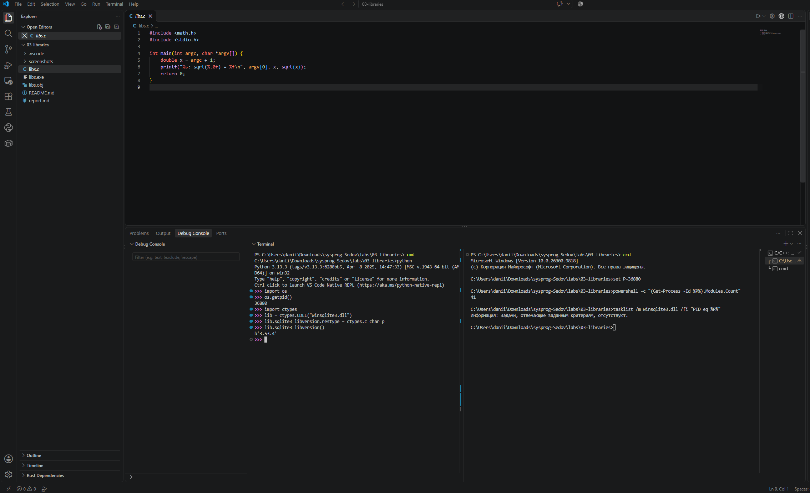
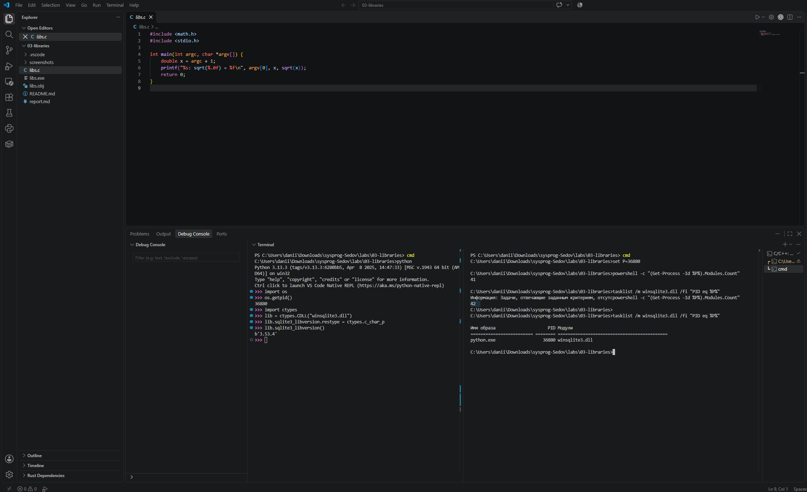

# ЛР 3. Библиотеки программы

Система: Windows x64.

## Библиотеки файла

Программа напечатала: `libs.exe: sqrt(2) = 1.414214`.

Команда для списка библиотек файла: `dumpbin /nologo /dependents libs.exe | findstr /i .dll`.

Библиотеки `libs.exe`: `KERNEL32.dll` и `api-ms-win-crt-...-l1-1-0.dll` для environment, heap, math, private, runtime, stdio, string и time.

В списке есть `api-ms-win-crt-math-l1-1-0.dll` — интерфейс математических функций среды выполнения C в Windows. Отдельной библиотеки с именем `libm` здесь нет.

Интерпретатор Python запускается из `C:\Program Files\Python313\python.exe`; в его зависимостях указана библиотека `python313.dll`.

## Библиотеки процесса

PID Python: `36880`.
До `ctypes.CDLL` в процессе было 41 модуль; после загрузки — 42. До загрузки `winsqlite3.dll` не обнаружена, после появилась в списке.

Загруженная библиотека: `winsqlite3.dll`. Её путь на этом компьютере проверен отдельным запуском: `C:\Windows\System32\winsqlite3.dll`.

Функция `sqlite3_libversion()` вернула `b'3.53.4'`.

## Помощник ИИ (Р1)

ИИ использовал для объяснения команд, устранения ошибки с PowerShell и заполнения отчёта. Сравнение ответа на запрос «Чем статическая компоновка отличается от динамической?» с таблицей §2 ещё не выполнено.

Не получилось: команда `for /f` сначала была введена в PowerShell; после перехода в `cmd` она выполнилась.

## Скриншоты

