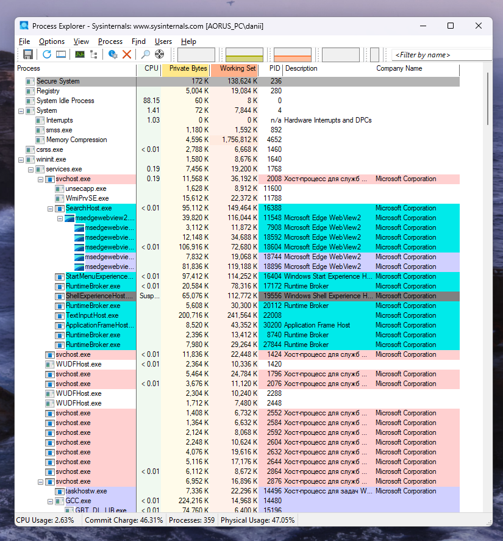
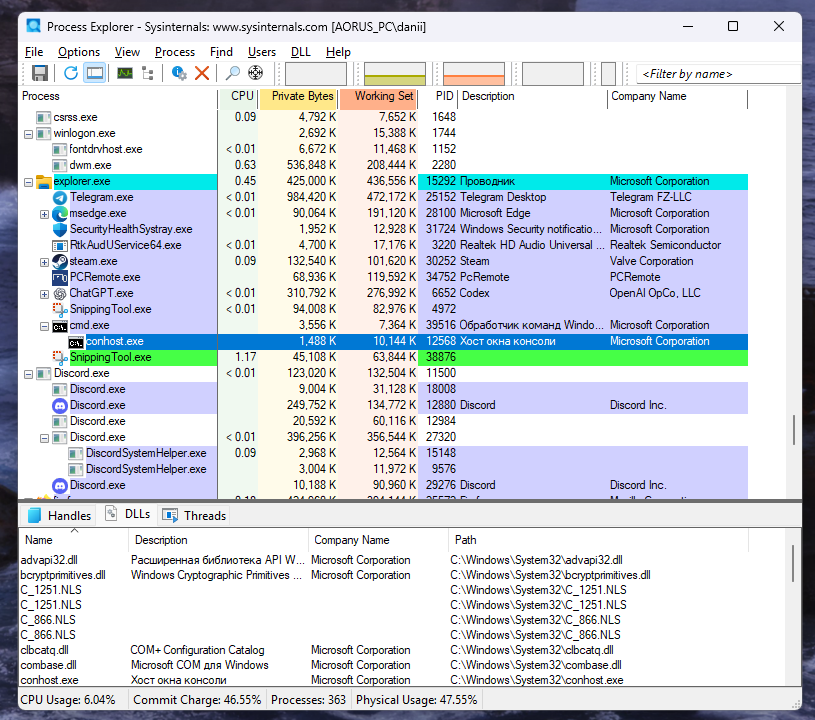
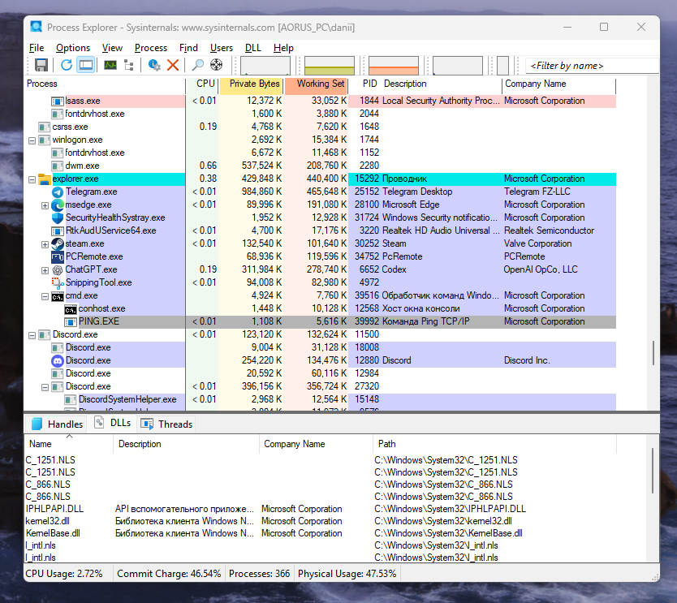
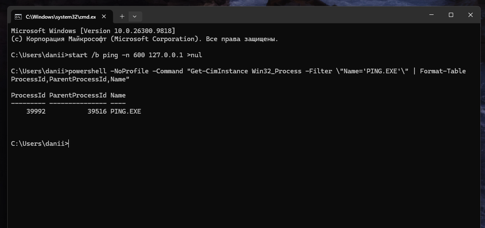
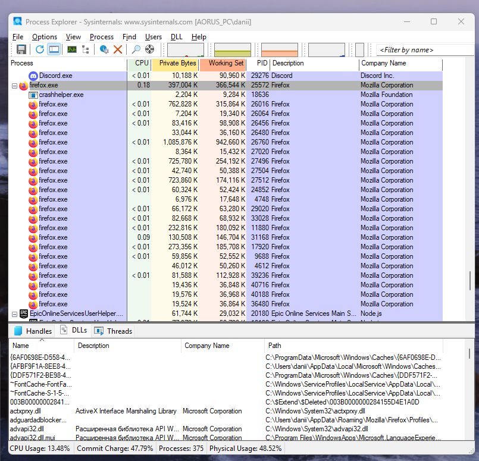
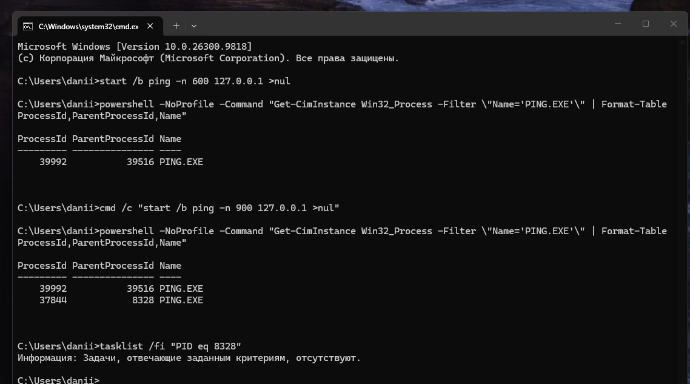
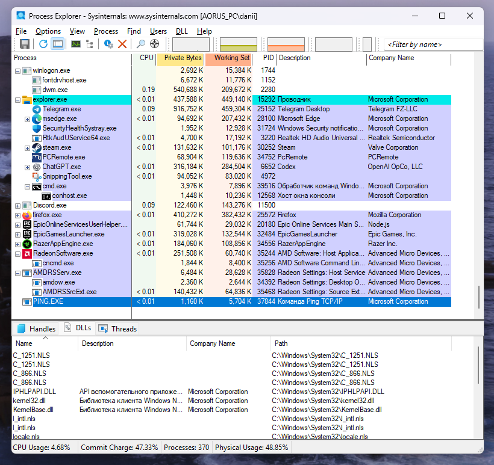

# ЛР 4. Дерево процессов

Система: Windows x64.

## Дерево

В начале списка видны системные процессы, в том числе `System` с PID 4 (также `System Idle Process` с PID 0).
На снимке ветка терминала: `explorer.exe` (PID 15292) → `cmd.exe` (PID 39516) → `conhost.exe` (PID 12568). Родитель `explorer.exe` на снимке не показан.
Дочерний процесс `PING.EXE`: PID 39992, родитель `cmd.exe` с PID 39516.

Команда для проверки родителя:

```cmd
powershell -NoProfile -Command "Get-CimInstance Win32_Process -Filter \"Name='PING.EXE'\" | Format-Table ProcessId,ParentProcessId,Name"
```

На снимке Firefox виден главный `firefox.exe` (PID 25572) и более 20 дочерних процессов `firefox.exe`, а также `crashhelper.exe`. Точное назначение каждого процесса по одному имени не определить.

## Сирота

Номер оставшегося процесса `PING.EXE`: PID 37844. Его родитель — временный `cmd.exe` с PID 8328; после завершения родителя в таблице остаётся `ParentProcessId = 8328`. Проверка `tasklist /fi "PID eq 8328"` показала, что такого процесса уже нет. Номер родителя до его завершения отдельно не снимался.

В Process Explorer оставшийся процесс показан отдельной строкой в конце дерева без видимого родителя.

Не получилось: существенных затруднений не возникло; номер для проверки родителя помог определить ИИ.

## Снимки экрана

Сохраните снимок поверх заглушки в папке `screenshots/` с тем же именем — ссылки ниже менять не нужно.

### 1. Начало дерева процессов
Шаг 1. Видно: дерево процессов в мониторе: первые процессы системы и их номера.



### 2. Терминал и его родители
Шаг 2. Видно: ветка дерева от процесса терминала вверх до процесса системы.



### 3. Дочерний процесс терминала
Шаг 3. Видно: запущенный из терминала процесс под оболочкой терминала.



### 4. Родитель по команде
Шаг 4. Видно: вывод команды с номером процесса и номером его родителя.



### 5. Процессы браузера
Шаг 5. Видно: раскрытая ветка браузера с дочерними процессами.



### 6. Процесс без родителя
Шаг 6. Видно: команда запуска и номер родителя у оставшегося процесса.



### 7. Сирота в дереве
Шаг 7. Видно: тот же процесс в дереве монитора на новом месте.


