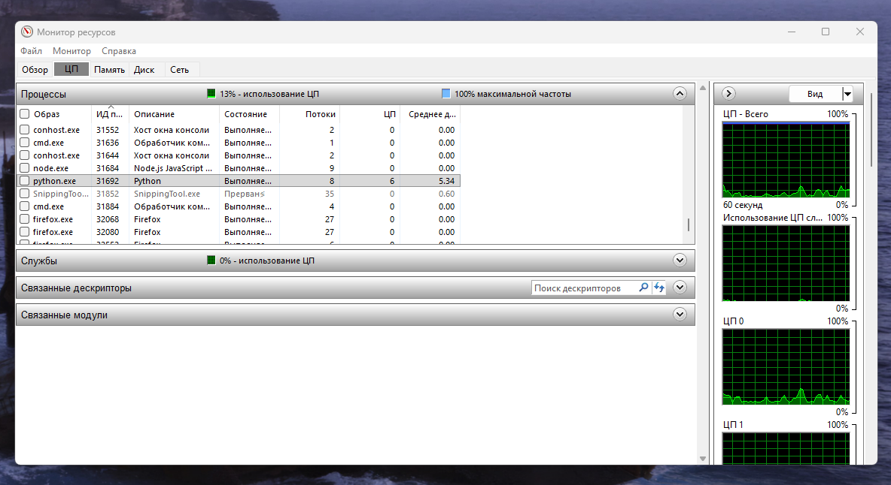
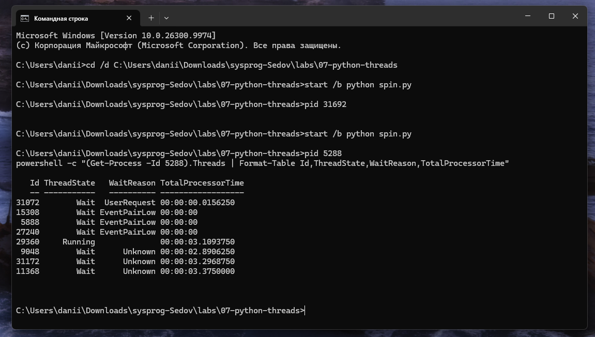
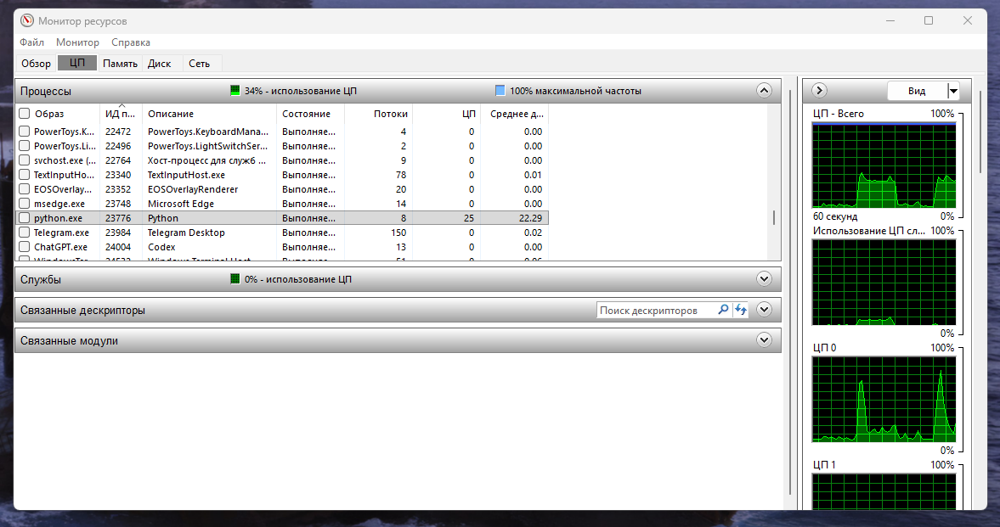
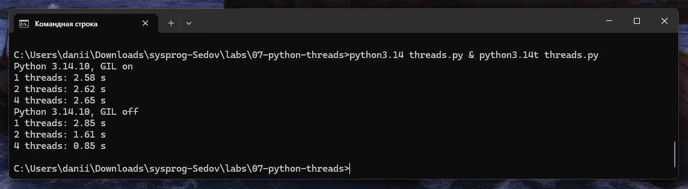

# ЛР 7. Потоки Python и GIL

Система: Windows x64.  
Логических процессоров: 16.  
Версии Python: 3.14.10 с GIL и 3.14.10 без GIL (free-threaded).

## Python с GIL

На снимке процесс использовал 6% ЦП и имел 8 потоков всего, включая 4 рабочих. В другом запуске снимок состояний показал один поток `Running` и семь `Wait`; это мгновенный срез. GIL допускает выполнение Python-кода одним потоком одновременно.

## Python без GIL

Процесс использовал 25% общего ЦП при 8 потоках всего. Проценты отдельных потоков на снимке не показаны.

## Время работы

С GIL, 1 / 2 / 4 потока: 2,58 / 2,62 / 2,65 с.  
Без GIL, 1 / 2 / 4 потока: 2,85 / 1,61 / 0,85 с.  
Версия без GIL с `PYTHON_GIL=1`, 1 / 2 / 4 потока: 2,83 / 2,90 / 2,89 с.  
Ожидание, 1 и 4 потока: 2,00 и 2,00 с.

Ожидающие потоки могут перекрывать ожидание: во время `sleep` поток освобождает GIL, и остальные могут работать или тоже ожидать. Поэтому четыре двухсекундных ожидания завершаются примерно одновременно.

Не получилось: проценты отдельных потоков версии без GIL не были зафиксированы. ИИ помогал с прохождением и заполнением отчёта.

## Снимки экрана

Сохраните снимок поверх заглушки в папке `screenshots/` с тем же именем — ссылки ниже менять не нужно.

### 1. Четыре потока с GIL
Шаг 1. Видно: процесс Python в мониторе: его процент и число потоков.

### 2. Потоки процесса
Шаг 2. Видно: список потоков процесса: сколько выполняется, сколько ждёт.

### 3. Четыре потока без GIL
Шаг 3. Видно: процесс python3.14t в мониторе: его процент.

### 4. Время работы
Шаг 4. Видно: вывод threads.py в Python с GIL и без.

