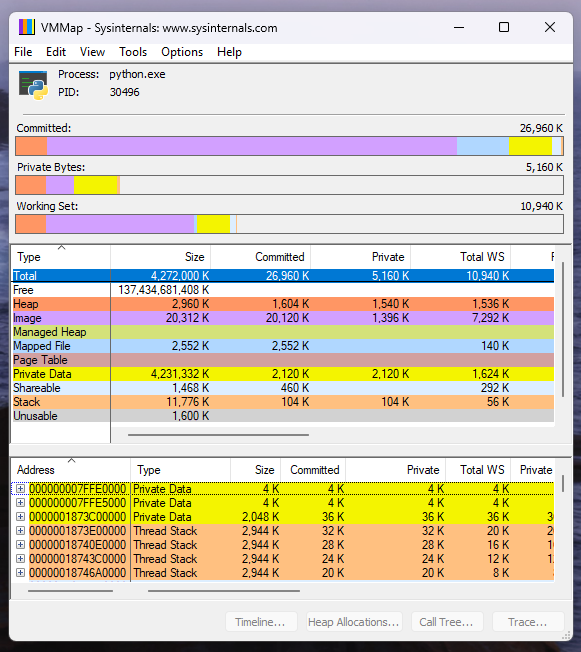
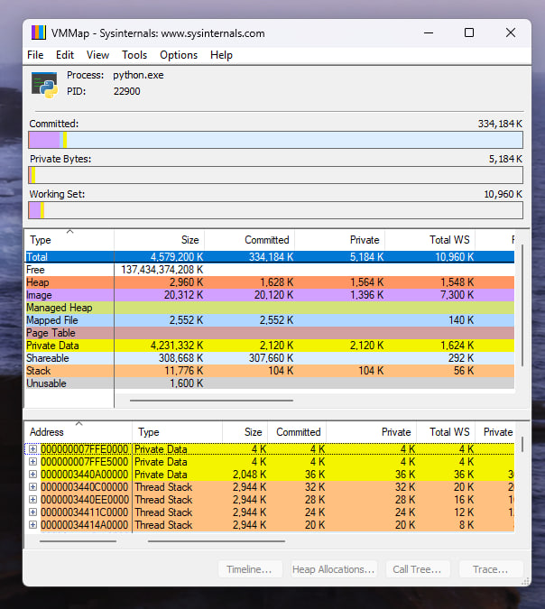
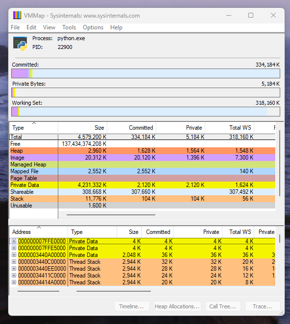
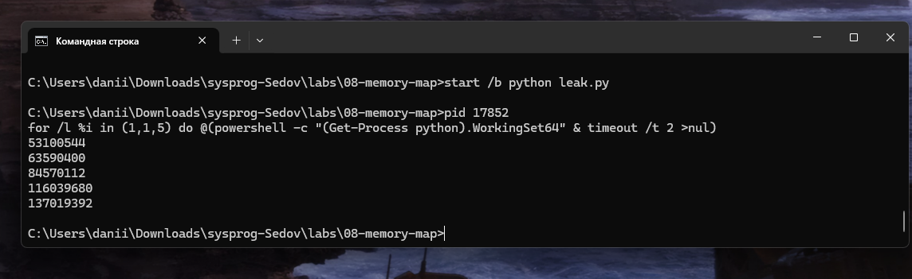

# ЛР 8. Карта памяти

Система: Windows x64.  
Чем мерил: VMMap — виртуальная память (`Committed`/`Size`) и занятая (`Working Set`/`Total WS`); для утечки — `Get-Process ... WorkingSet64`.

## Этапы mem.py

Старт (PID 30496): committed 26 960 КБ, private 5 160 КБ, working set 10 940 КБ.  
Получил 300 МБ (PID 22900): committed 334 184 КБ, private 5 184 КБ, working set 10 960 КБ.  
Записал в каждую страницу: committed 334 184 КБ, private 5 184 КБ, working set 318 160 КБ.  
Освободил: committed 26 984 КБ, private 5 184 КБ, working set 10 964 КБ.

Занятая память выросла только на третьем этапе, потому что резервирование виртуального адресного пространства не обязано сразу выделять физические страницы. Физические страницы подключились, когда программа записала данные в каждую страницу.

## Карта памяти

Память процесса состоит из свободных областей, кучи, образа программы и DLL, отображённых файлов, таблиц страниц, приватных данных, разделяемой памяти, стека потоков и непригодных областей.

## Утечка

Пять замеров `WorkingSet64` для `leak.py`: 53 100 544; 63 590 400; 84 570 112; 116 039 680; 137 019 392 байта.

За 2 секунды память росла примерно на 20–21 МБ: разница между первым и третьим замерами за 4 секунды — 31 469 568 байт, а между третьим и пятым — 52 449 280 байт; рост не идеально равномерен из-за работы сборщика и обновления процесса.

Не получилось: второй снимок сначала был сохранён с расширением JPG, затем сохранён как `02_reserved.png`. ИИ помогал с расшифровкой показателей VMMap и заполнением отчёта.

## Снимки экрана

Сохраните снимок поверх заглушки в папке `screenshots/` с тем же именем — ссылки ниже менять не нужно.

### 1. Карта памяти
Шаг 2. Видно: карта памяти процесса mem.py на старте и её итог.

### 2. Получено 300 МБ
Шаг 3. Видно: виртуальная память выросла на 300 МБ, занятая — нет.

### 3. Страницы заняты
Шаг 4. Видно: занятая память (в macOS — физический след) после записи в каждую страницу.

### 4. Утечка
Шаг 6. Видно: пять замеров памяти leak.py.

