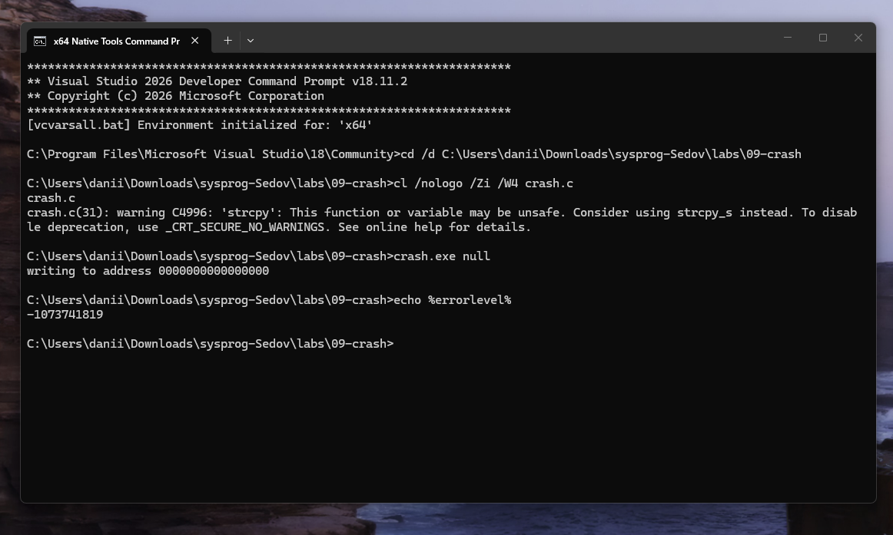
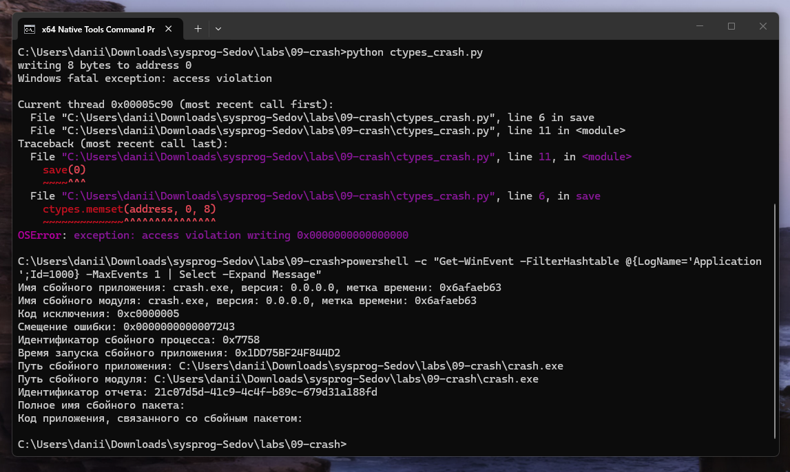
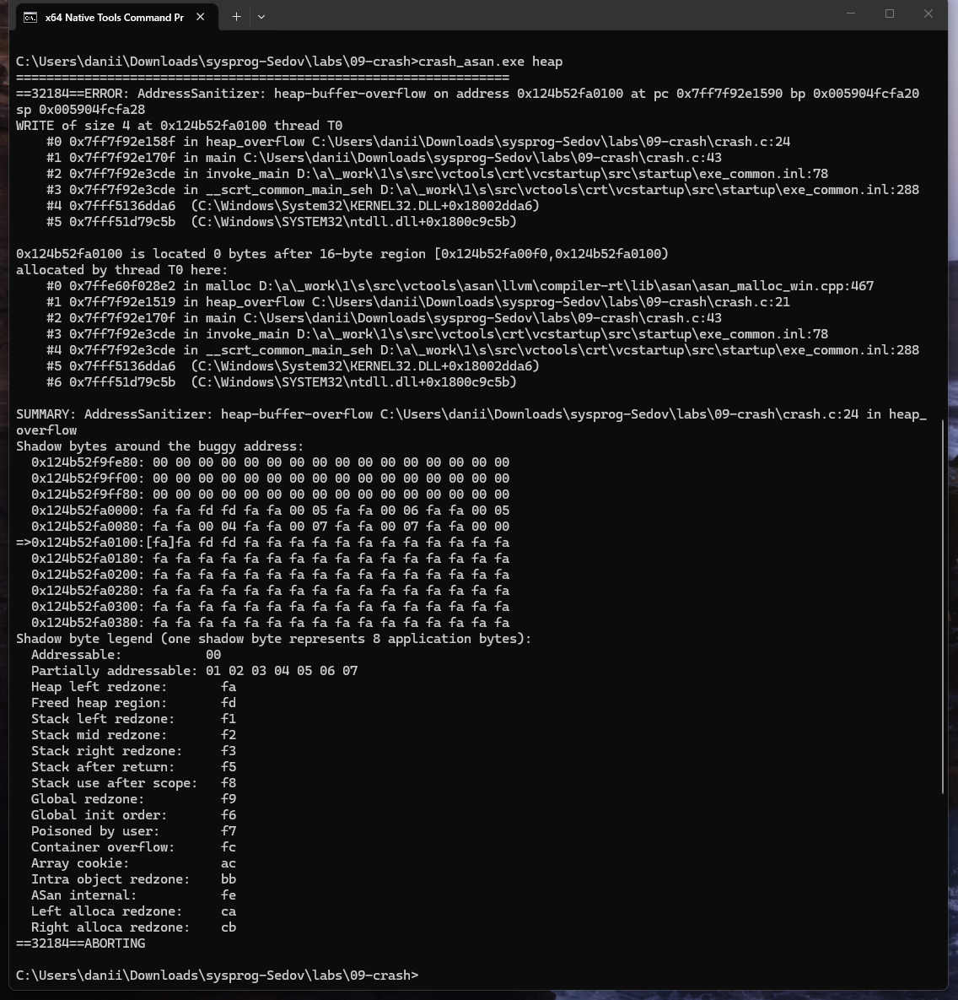
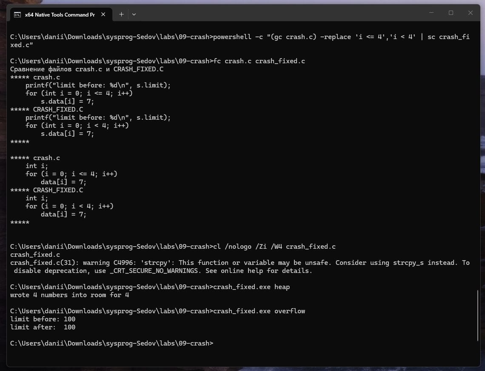

# ЛР 9. Разбор падения

Система: Windows x64.  
Компилятор: Microsoft C/C++ Optimizing Compiler 19.51.36260 for x64.

## Падение

`crash.exe null` напечатала адрес `0000000000000000` и завершилась с кодом `-1073741819` (`0xC0000005`, нарушение доступа).

`ctypes_crash.py` не успела напечатать пользовательскую строку: Python завершился из-за нарушения доступа при записи по адресу 0.

Сбой Python записан Windows в журнале **Application**, событие `Application Error` с ID 1000.

## Молчаливые ошибки

`crash.exe overflow`: `limit` до записи — 100, после — 7, код завершения 0.

`crash.exe heap` без проверки напечатала, что записано 5 чисел в область на 4 числа, и завершилась без сообщения об ошибке.

AddressSanitizer для heap: `heap-buffer-overflow`, запись за пределы выделенной области в `crash.c:24`; память выделена в `crash.c:21`.

AddressSanitizer для uaf: `heap-use-after-free`; чтение произошло при печати в `crash.c:33`, память освобождена в `crash.c:32`.

## Исправление

В `crash_fixed.c` оба цикла изменены с `i <= 4` на `i < 4`. Исправленная программа записывает ровно четыре значения, не портит `limit` и успешно завершается: для `heap` — `wrote 4 numbers into room for 4`, для `overflow` — `limit before: 100` и `limit after: 100`.

Не получилось: AddressSanitizer доступен в установленной конфигурации x64; существенных проблем при выполнении лабораторной не возникло. ИИ помогал с расшифровкой сообщений и заполнением отчёта.

## Снимки экрана

Сохраните снимок поверх заглушки в папке `screenshots/` с тем же именем — ссылки ниже менять не нужно.

### 1. Падение
Шаг 1. Видно: запуск crash null и код завершения.

### 2. Падение Python
Шаг 2. Видно: вывод ctypes_crash.py и запись системы о падении.

### 3. Отчёт AddressSanitizer
Шаг 4. Видно: вывод crash heap без проверки и с AddressSanitizer (на Windows с ARM — без проверки).

### 4. Исправление
Шаг 6. Видно: разница файлов и вывод исправленной программы.

